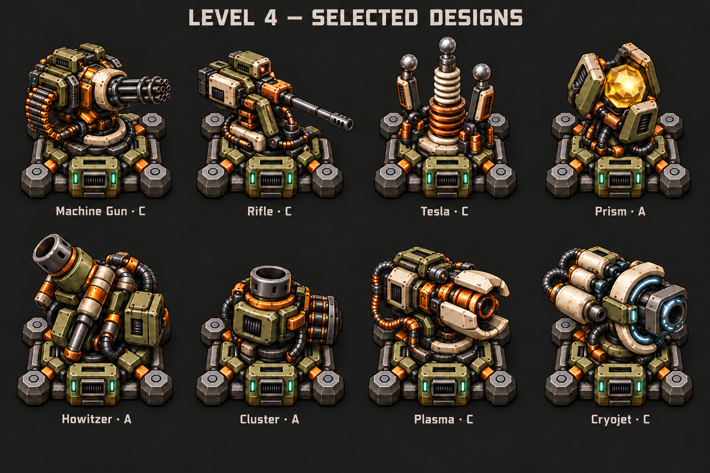

# Level 4 tower art — approved selection

Approved by the user on 2026-10-29: the second, corrected consolidated sheet.

| Specialization | Selected concept |
| --- | --- |
| Machine Gun | C |
| Rifle | C |
| Tesla | C |
| Prism | A |
| Howitzer | A |
| Cluster | A |
| Plasma | C |
| Cryojet | C |

A = Heavy Industrial. C = Experimental Arsenal. The first consolidated sheet
incorrectly substituted Machine Gun and Plasma from A; it is not approved and
is deliberately excluded. The corrected sheet above is the selected visual reference.

## Provenance

Generated with the built-in image generation tool, then copied without resizing,
repainting, slicing, or conversion. Original output:
`exec-1222ac49-3c2f-467c-87a2-fae90c5120b7.png`.

SHA-256: `3007588cce9319e7bafc79654605573a6e43b0b63d2f1efe3de29114076f5fb9`.

Only the final approved reference is archived here; exploratory sheets are excluded.

## Approval boundary and next step

Approval covers the pictured appearance, not runtime animation or in-game validation.
This is an opaque concept sheet with labels, not a ready-to-load transparent atlas.
The reference-only archival commit `b2ec96c` changed no game code. Runtime
implementation and its verification status are tracked in `../../work/towers/level4-towers-v1.md`.
The animation ideas discussed before this selection remain proposals.

Next: prepare separate components and directional/animation sprites from these
selected designs, one visual iteration at a time. Preserve their silhouettes,
materials and distinctive parts. Cluster fires one capsule that opens in flight;
it must not become a multi-tube launcher. Keep foundations stationary and use the
platform camera. Verify whole-frame and close-up readability, grayscale contrast,
complete movement cycles and disk-browser behavior through user-run checks before
claiming runtime completion.
