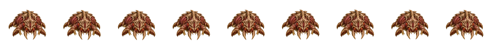
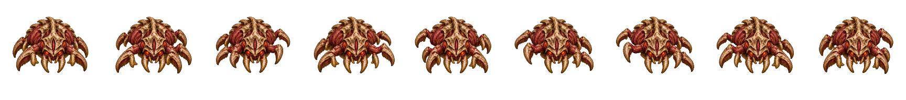
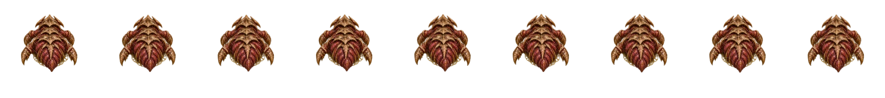
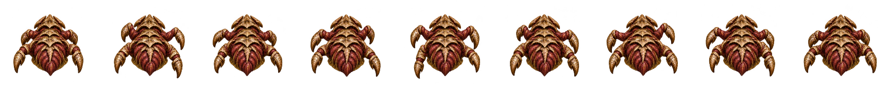

# Вертикальная походка Фуражира

Исправлен текущий `assets/hunger-forager-mire-v2.webp` (версия уточнена пользователем). Ветка `codex/forager-vertical-gait` начата от свежего `main` — `74235d75`. Изменены только ряды **3,4,5,11,12,13**: два вертикальных направления и непосредственные соседи±22,5°. Десять других рядов и старый атласv1 сохранены.

Вместо деформации одной неподвижной позы использованы два цельных девятикадровых цикла переднего/заднего ракурсов. Они созданы встроенным imagegen по исходным кадрам утверждённого атласа: [точные запросы](../../assets/art/forager-vertical-cycles-v1.prompt.txt), [передний исходник](../../assets/art/sources/forager-vertical-front-cycle-v1.webp), [задний исходник](../../assets/art/sources/forager-vertical-rear-cycle-v1.webp). Это новые интерпретации поз, а не восстановленная 3D-модель; пиксельная неизменность гарантируется только для нетронутых рядов.

Запекатель нормализует все 18 поз одним масштабом и привязывает их к верхнему панцирю. Ближайшие направления проецируются из соответствующего вертикального цикла. Кадр переносится одной аффинной операцией, без растягивания отдельных масок ног и треугольных швов. Контакты видимых лап обновляются вместе с атласом; другие строки контактов остаются прежними. Функции боя, баланс, путь, позиции площадок,40px ритм шага и существующее покачивание не менялись.

## Девять кадров: до / после

Ряд 4:




Ряд 12:




## Измерение и сохранность

Средняя абсолютная разница **видимого RGB**, с учётом альфы, по 8 соседним парам девяти кадров (rest0+походка 1–8), шкала 0–255. Цвета под прозрачными пикселями не увеличивают результат. Числа запроса получены другой, не указанной метрикой; здесь сравнение выполнено одной формулой для всех рядов.

| Ряд | До | После |
|---|---:|---:|
| 3 | 1,952 | 9,279 |
| 4 | 2,334 | 10,947 |
| 5 | 2,480 | 9,288 |
| 11 | 1,568 | 10,115 |
| 12 | 1,866 | 12,097 |
| 13 | 2,176 | 10,114 |
| Боковой 0 | 7,926 | 7,926 |
| Боковой 8 | 7,930 | 7,930 |

[Полные числа](metrics.json). В противоположных позах 1/5 меняется не только цвет, но и силуэт лап с обеих сторон: ряд 4 —1226/1185 пикселей, ряд 12 —271/645; до —70/222 и 174/70 соответственно. Это дополнительная проверка, визуальный просмотр она не заменяет.

Все 10 нетронутых рядов совпадают побайтово в декодированном **RGBA, включая невидимые RGB при alpha0**: [SHA256](raw-rgba-preservation.json). Повторное запекание даёт те же SHA256 всего атласа и JSON контактов. Для сохранности используется exact lossless WebP; размер атласа вырос с 1566668 до 3591310 байт. Геометрия 1728×3072 и сетка 192×192 не менялись.

## Кадры из игры

Сняты реальным рендерером из `tools/capture-organic-world.cjs` через его `loadWorld`, с обычным fixed-step движением и проверкой неизменности replaySignature при рисовании.

- Общий кадр: [до](game-before.png), [после](game-after.png).
- Ряд 4 в игре: [до](game-row-4-before.png), [после](game-row-4-after.png), [циклGIF](game-row-4-after.gif).
- Ряд 12 в игре: [до](game-row-12-before.png), [после](game-row-12-after.png), [циклGIF](game-row-12-after.gif).

Просмотрены оба атласных ряда, все девять игровых фаз и общий кадр, в том числе в оттенках серого. Видно чередование сторон, конечности связные, прежние лоскуты/сетка отсутствуют. Независимый второй просмотр также не нашёл блокирующих дефектов в новой версии. Пиксельная фиксация каждой опоры относительно движущейся жижи и browser/mobile-производительность не подтверждались этой проверкой.

## Повторение

Для запекания нужен Python с Pillow, только как офлайн-инструмент:

```sh
FORAGER_PYTHON=/path/to/python-with-pillow node tools/bake-forager-crawl-v2.cjs
node tests/forager-crawl-atlas.cjs
node tests/forager-vertical-gait.cjs
node tools/capture-forager-vertical.cjs after
npm test
```

`FORAGER_CANVAS_MODULE` и `WORLD_CANVAS_MODULE` при необходимости задают расположение `@napi-rs/canvas`. По умолчанию используется локальная зависимость после `npm install`.

Все указанные тесты прошли, включая полный `npm test`. Новая регрессия до исправления падала на исходном атласе. Промежуточные коммиты сохранены: `cb17f7b` — исходник и падающий тест; `e763b54` — отвергнутый визуальным просмотром эксперимент. В итоговой реализации этот эксперимент удалён. PR не вливался.
