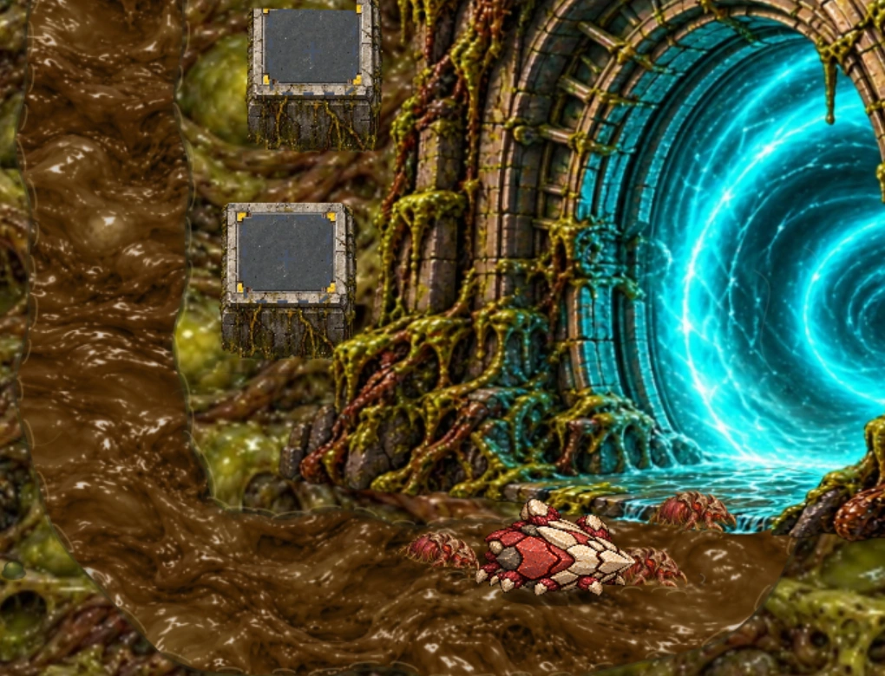
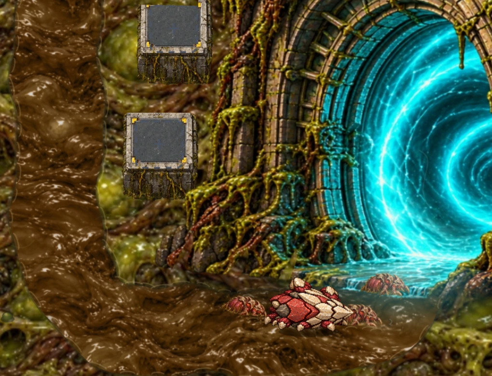
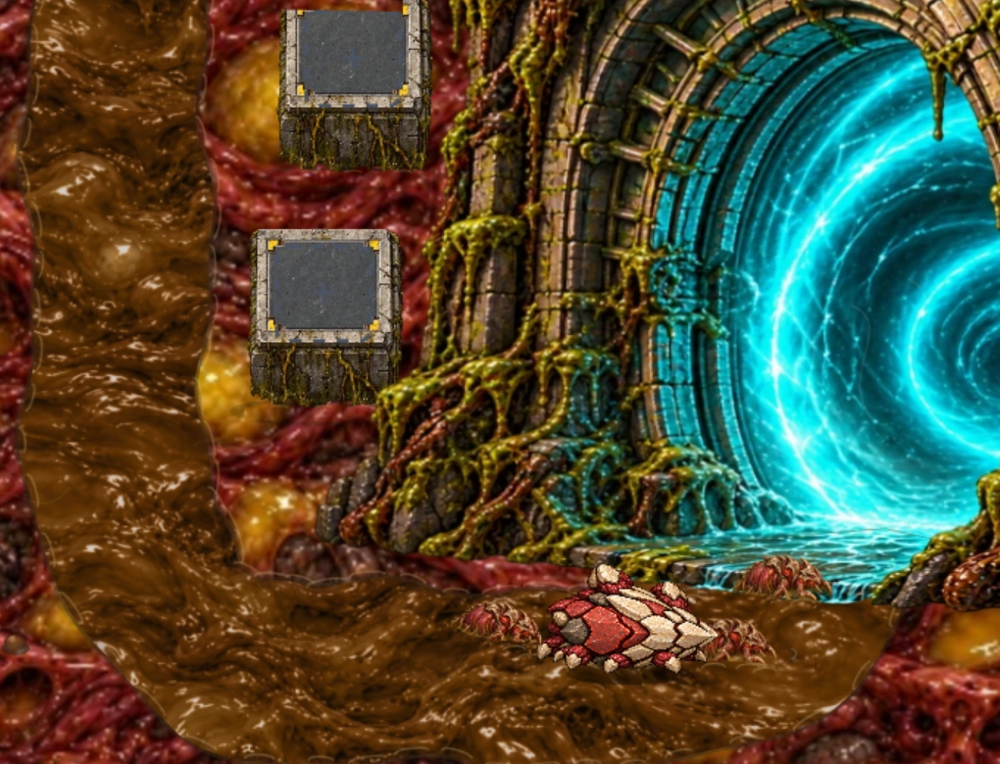
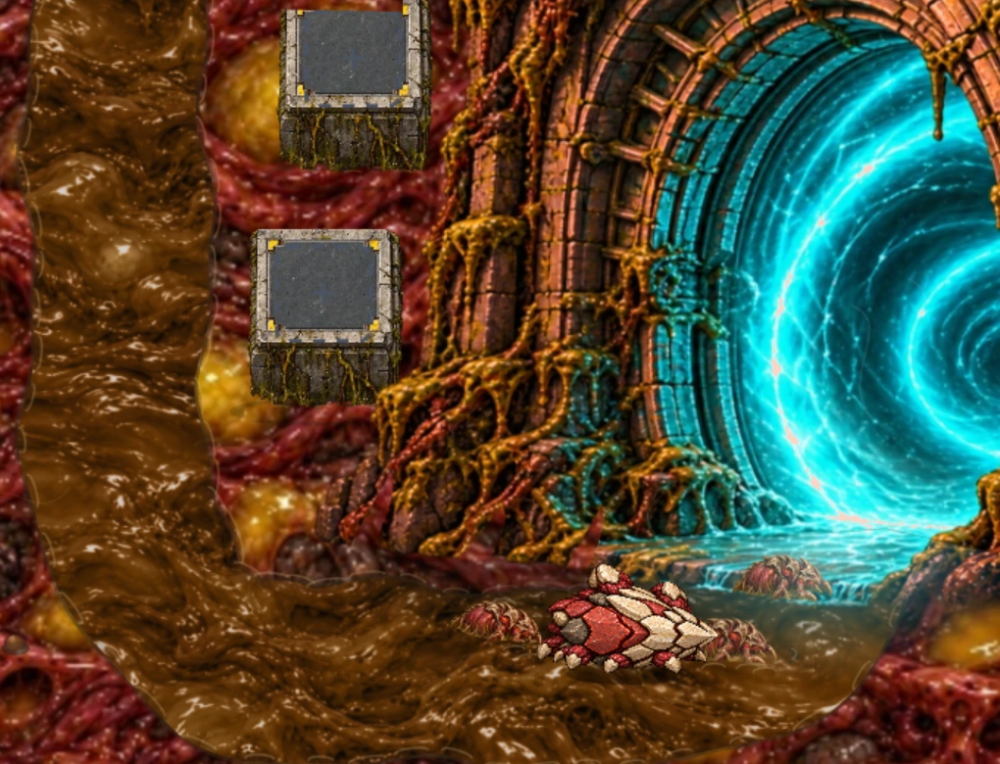

# Ворота: контакт с картой

Ветка `codex/gate-ground-integration`, база `main` — `284f3c2`, с телепортацией и локальными движениями грунта.

Фронтальный ракурс и положение Ворот сохранены. В отрисовке нижний край стал неровным и полупрозрачным, через него проступает окружающая жижа. Узкие наросты из той же мировой текстуры поднимаются на нижнюю кладку. Перед Воротами появилась мягкая тень, на земле и телах рядом — голубой свет с затуханием на расстоянии 80 игровых пикселей. Подсветка тел ограничена силуэтом спрайта. Кладка и мох теплее в Ember, приглушённо-оливковые в Mire; голубой проём исключён из цветокоррекции.

Новых исходных изображений нет: обработанный материал кешируется при отрисовке. Для подсветки тел переиспользуется одна небольшая маска. Бой, баланс, путь, точка утечки, площадки и геометрия проёма не менялись.

## Кадры из игры

| Зона | До | После |
|---|---|---|
| Mire |  |  |
| Ember |  |  |

Общий план: [Mire до](mire-before.webp) / [после](mire-after.webp), [Ember до](ember-before.webp) / [после](ember-after.webp).

Читаемость без цвета: [Mire](mire-gray.webp), [Ember](ember-gray.webp). В кадре четыре врага на разных расстояниях от проёма, включая крупного Карапацида. Первый вариант оставлял коричневый фрагмент неосвещённой жижи под Фуражиром; в итоговой версии контактный слой использует тот же освещённый пол, что виден вокруг.

Съёмка — настоящий игровой renderer через `loadWorld` из `tools/capture-organic-world.cjs`, фиксированное состояние и одинаковый масштаб. Это нативные кадры, не проверка браузера или производительности на устройстве. Кадры ещё требуют пользовательской художественной оценки; тесты не заменяют её.

## Проверка

`tests/gate-integration.cjs` проверяет обе палитры, отпечатки боя/геометрии, неизменный верхний силуэт, сохранение голубого проёма, смешивание нижнего края, тёплую коррекцию Ember, радиус подсветки, изменение пикселей тел всех трёх каст и точное совпадение пола с контактным слоем Фуражира. Отдельно пройдены существующие проверки телепортации, мира и Фуражира.

Полный `npm test` прошёл: `all tests passed`. Чекпоинт — `reports/ACTIVE-WORK-CHECKPOINT.md`.

Пересъёмка:

```sh
node tools/capture-gate-integration.cjs
node tools/capture-gate-integration.cjs --ember
```

Публикация после просмотра (локальные коммиты уже сохранены):

```sh
cd ~/github/game &&
git checkout codex/gate-ground-integration &&
git status &&
git push -u origin codex/gate-ground-integration &&
gh pr create --base main --title "Integrate Gate footing and portal light with both zones" --body-file reports/gate-integration/PR.md
```
