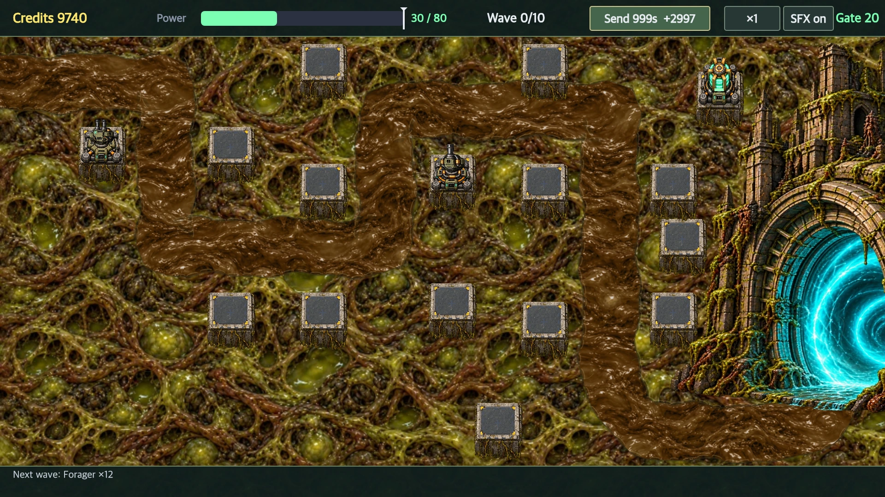
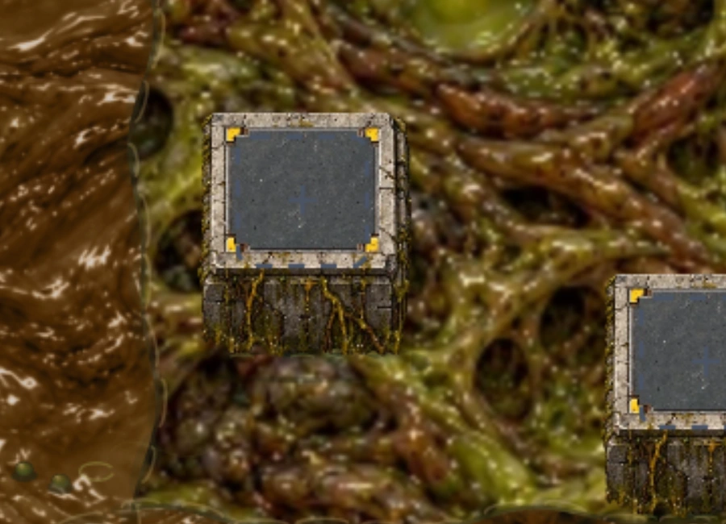
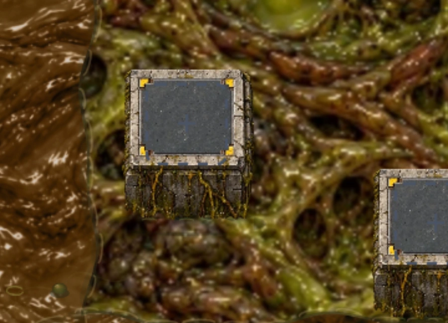

# Локальная жизнь грунта

Ветка `codex/local-ground-life`, текущая база `origin/main`: `72248f5`, включая слитую пользователем телепортацию (PR #43). Исходные кадры и baseline сняты на `9298dd2`; геометрия и бой те же.

Убрана деформация сетки всей карты и синхронная пульсация прожилок. Вместо неё — 16 независимых очагов: пузыри, короткие бугры от движения под жижей и рябь. Области имеют диаметр 24–52 игровых пикселя; периоды 4.5–8.4 секунды, фазы различаются. Основная текстура копируется без смещения и масштабирования во времени.

Под площадками и всей областью Врат восстанавливается неподвижный грунт, включая случаи проходящих рядом существ и их следов. У основания площадки добавлены узкая тень контакта и неподвижный нахлёст окружающей жижи на нижние 1–3 пикселя стены. Высота площадок, плотность исходной текстуры, бой и геометрия карты не менялись.

## Визуальные материалы

Общий план при одинаковом состоянии игры и времени:

| До | После |
|---|---|
|  |  |

Площадка и окружающий грунт — три кадра с интервалом в секунду. Слева внизу меняются пузыри, основание и неподвижная текстура сохраняют положение:

| t | t + 1 с | t + 2 с |
|---|---|---|
|  |  |  |

[Площадка до изменения](before-pad-0s.webp) · [Полный план +1 с](after-1s.webp) · [Полный план +2 с](after-2s.webp) · [9-секундный цикл](pad-cycle.mp4) · [Оттенки серого](after-gray.webp).

Материалы сняты из настоящего игрового renderer через `loadWorld` в `tools/capture-organic-world.cjs`; симуляция зафиксирована, меняется только время отрисовки. Просмотрены общий кадр до/после, крупные планы, последовательность фаз пузырей и серый кадр. Первую версию слишком плоских пузырей заменили затенёнными с небольшим бликом. Добавленные движения не перекрывают площадки и не требуют изменения перспективы. Подвижность врагов в бою и вывод в браузере в этой задаче не проверялись.

## Проверка пользователем

По последнему указанию пользователя тесты, коммит, push и merge выполняет пользователь. **Тесты здесь не запускались.** Подготовлен `tests/local-ground-life.cjs`: он сравнивает пиксели всей поверхности вне очагов, проверяет неподвижность основания даже рядом с существом, движение каждого очага, количество/размеры, разные фазы/периоды и исходные отпечатки боя/геометрии в обеих палитрах. Старая деформация должна нарушить проверку неподвижности. Обновлена устаревшая проверка «грунт дышит» в инструменте съёмки.

Из текущей рабочей копии (изменения уже лежат в этой ветке):

```sh
cd ~/github/game
git status --short --branch
node tests/local-ground-life.cjs
npm test
```

После зелёных тестов и просмотра кадров:

```sh
git add prototype/index.html tests/local-ground-life.cjs tools/capture-organic-world.cjs tools/capture-local-ground-life.cjs reports/local-ground-life reports/ACTIVE-WORK-CHECKPOINT.md
git commit -m "Replace global terrain breathing with local mud activity"
git push -u origin codex/local-ground-life
gh pr create --base main --fill
```

Для пересъёмки: `node tools/capture-local-ground-life.cjs --cycle`. MP4 создаётся отдельно из PNG в `reports/generated/local-ground-life/cycle`. `--before` запускается только на исходной версии: он перезаписывает baseline.

Резервный патч: `reports/generated/local-ground-life.patch`. Это обычный binary diff для `git apply`, без коммитов; в текущей рабочей копии повторно применять его не нужно. Чекпоинт: `reports/ACTIVE-WORK-CHECKPOINT.md`. Не добавлять пользовательский `reports/NEW-CHAT-HANDOFF.md` и черновые PNG.
